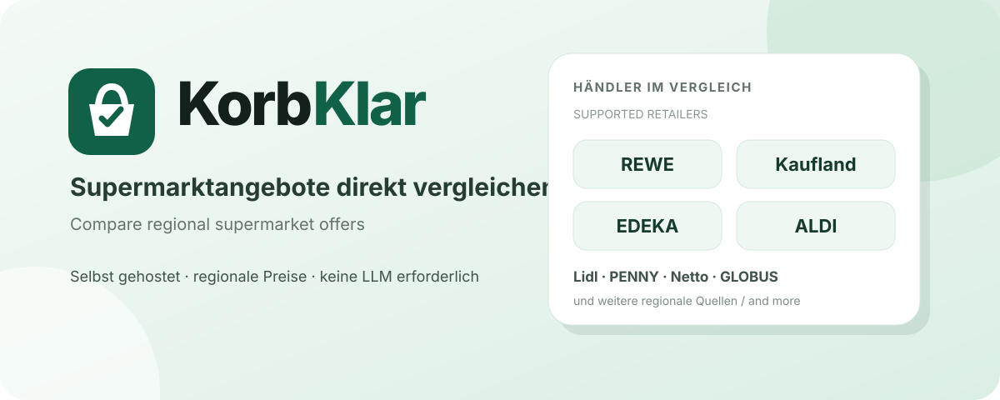

# Korbuino

## Choose your language / Sprache wählen

🇩🇪 [Deutsch](README.de.md)

🇬🇧 [English](README.en.md)

## Einkaufsliste, Favoriten und optionale Meldungen

Die native Android-App bietet Händlerabschnitte, bearbeitbare Packungsmengen und
separate Angaben zu Warenwert, Pfand und Bonusguthaben. Favoriten funktionieren
ohne Server und ohne Benachrichtigungsdienst. Für optionale Angebotsmeldungen
trägst du dein selbst gewähltes HTTPS-ntfy-Topic in den Einstellungen ein und
abonnierst dasselbe Topic im ntfy-Client. Die App empfängt selbst keine Pushs.
Eine ntfy-Konfiguration aktiviert keine Hintergrundabfragen automatisch.

Mehrkaufangebote gelten nur ab der angegebenen Menge. Unbekannte Einzel- oder
Restpreise werden nicht erfunden. Aktuelle Angebote und echte Vorschauen werden
getrennt angezeigt; nicht jeder Händler stellt Vorschauen bereit.

Details: [Einrichtung, Einkaufsplan und Beobachtungen](docs/einkaufen-und-beobachten.md).
